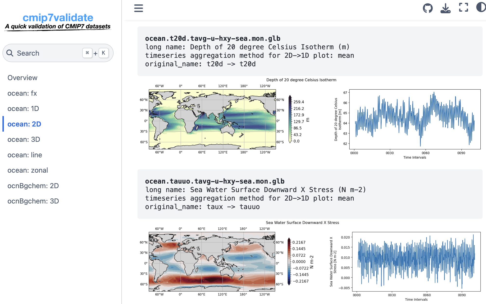

# Summary

`cmor4cmip7` is an integrated workflow to convert, repack and validate the native
Earth System Models (ESMs) output into the file format and metadata required by
the Coupled Model Intercomparison Project phase 7 (CMIP7). 
The conversion tool as a command line  is written in Fortran and builds on the
Fortran application programming interface of the Climate Model Output Rewriter
(CMOR) library [@cmorlib]. The converted ESMs output in the CMIP7 format is furtherd
repacked with consolidated metadata and larger data chunks using the Python-based community tool
`cmip7repack`[@Hassell2026] to ensure efficient cloud-based data access.
The datasets are scientifically validated with the companion tool `cmip7validate`[@cmip7validate]
developed with Jupyterbook as part of the workflow before it is published through the Earth System Grid Federation [ESGF; @Cinquini2014]. 

It is released under the MIT license at <https://github.com/NorESMhub/cmor4cmip7>,
and documentated at <https://cmor4cmip7.readthedocs.io>.

# Statement of need

Climate model intercomparison depends on the output of many models being archived in
a single, machine-readable form. Each centre must deliver its simulations with
prescribed variable definitions, units, coordinates, metadata, file names and
directory structure, as specified by the CMIP7 data request [@Mackallah2026] and the
CMIP7 controlled vocabularies[@cmip7-cvs].
For a coupled Earth system model this conversion is routine but demanding:
the model writes output on native grids with model-specific
variable names, vertical coordinates and time-axis conventions, while the data
request defines more than a thousand variable specifications, each with its own
realm, frequency, region and cell methods. The step is repeated for every experiment,
ensemble member and data version, and in a multi-petabyte archive there is little
room for manual correction afterwards.

`cmor4cmip7` provides a dedicated tool for this step, reducing it to a few namelist
configurations so that the decisions of a production run — which variables, from
which simulations, with which metadata — are written down explicitly rather than
embedded in ad hoc scripts. Recipes are version-controlled and can be compared,
reviewed and reused, which makes runs auditable and reproducible and allows selective
reprocessing, for example after a bug fix.

# State of the field

Data producers have several options for preparing CMIP-style output. Some centres
combine generic post-processing tools, such as the CMOR functionality of CDO
[@cdocmor], with custom scripts and manual metadata editing. Such workflows can be
sufficient for a single experiment, but they are difficult to reproduce and to audit,
and they tend to break when the data request or the model output conventions change.

Because CMOR provides APIs for C, Fortran and Python [@cmorlib], most recent tools
build on one of them. Python tools include NCAR's `cmip7-prep` [@cmip7-prep], the
AWI/GEOMAR's `pycmor` package [@pycmor] and the EC-Earth `ece2cmor3` tool [@ece2cmor3].
These benefit from the mature Python ecosystem and are easy to extend,
but they bring a long dependency chain to maintain on every platform,
and interpreter and library overhead in a throughput-bound task.

The CMOR library is written in C, and a tool built directly on the C API would in
principle have the lowest overhead; in practice, C is rarely used in the Earth system
modelling community, and no such tool exists. The Fortran API of CMOR is a thin
wrapper around the C library, and Fortran remains the dominant language of climate
and weather models. `cmor4cmip7` fills this gap, harnessing the CMOR Fortran API through
namelist configuration and keeping the dependency chain close to that of CMOR
itself.

# Software design

`cmor4cmip7` is organised around the model realms represented in an Earth system
simulation and around the distinction between model-specific and CMIP7-specific information. 
Everything that is specific to a model lives in a JSON mapping file
that associates native field names and grid information with CMIP7 variable definitions;
everything that is specific to a production task lives in a few Fortran namelist files —
for the computing system, the model, the experiment and the variables.
Together these files form a *recipe*:
plain text that can be version-controlled, reviewed and repeated by others.
The program reads the recipe from the command line:
```bash
$ ./cmor4cmip7 system.nml model.nml experiment.nml variables.nml
```

The dictionaries of CMIP7 variables, dimensions and controlled vocabulary terms are
taken from the official CMIP7 CMOR tables [@cmip7-data-request], so that revisions
of the data request are absorbed by updating the tables rather than by editing the
source code.

For each requested variable, `cmor4cmip7` locates the native model field, applies the
required units, dimensions, coordinates, cell methods and global attributes,
and then pass the fields and its metadata to the CMOR Fortran API and
writes a CF-compliant NetCDF file with the CMIP7 file naming and directory structure.
The datasets can be validated and published through the Earth System Grid Federation
[@Cinquini2014].

The separation of model, task and CMIP7-specific information keeps the workflow small
and gives it the following properties:

* **Minimal dependencies** — a single executable linked to CMOR, NetCDF Fortran,
  json-fortran and GSW-Fortran, with no scripting runtime.
* **One workflow for all realms and frequencies** — the same namelist structure and
  code path produce atmosphere, ocean, sea ice and land output.
* **Selective processing** — any subset of variables can be regenerated, as is needed
  for operational bug fixes.
* **Simple parallelisation** — variables are independent, so the optional MPI build
  adds throughput without extra infrastructure.
* **No intermediate data copies** — time slices are written directly from native model
  output into CMIP7-compliant files.

The `cmor4cmip7` is compiled with a small makefile for GNU or Intel compilers; module,
build and run scripts for the Norwegian HPC systems are included. The repository also
contains unit tests for the JSON and namelist handling, a template recipe, and sample
recipes used for NorESM3 CMIP7 production. `cmor4cmip7` is developed at
<https://github.com/NorESMhub/cmor4cmip7>, documented at
<https://cmor4cmip7.readthedocs.io> and released under the MIT license.

The converted ESMs output in the CMIP7 format is furtherd
repacked with consolidated metadata and larger data chunks using the Python-based community tool
`cmip7repack`[@Hassell2026] to ensure efficient cloud-based data access.
The datasets are scientifically validated with the companion tool `cmip7validate`[@cmip7validate]
developed with Jupyterbook as part of the workflow, as demostrated in \autoref{fig:cmip7validate}, before it is published through the Earth System Grid Federation [ESGF; @Cinquini2014]



The software was developed for the Norwegian Earth System Model (NorESM3), and currently be operational only for its ocean and ocean biogeochemistry components. However, this integrated workflow and tools are highly modulized, efficient and flexible, it can be adapted to other model components and models with a comparable component layout.

# Research impact statement

By reducing a production task to a versioned recipe,
the integrated workflow `cmor4cmip7` removes a repetitive manual step
and keeps the archived data consistent with the data request across experiments,
ensemble members and model versions. The resulting datasets are checked with the
companion tool `cmip7validate` [@cmip7validate] and published through the ESGF,
where they are used by the Rapid Evaluation Framework
of the CMIP7 Assessment Fast Track [@Hoffman2026]. Such multi-model archives are the
basis for the analyses that address the science questions defined for CMIP7
[@Dunne2025], including climate change assessment, adaptation and mitigation, and
predictions on seasonal to decadal timescales. The results will be one of major scientific evidence
from modelling perspective for the upcoming Seventh Assessment Report by the Intergovernmental Panel on Climate Change (IPCC AR7).

# AI usage disclosure

The authors wrote this manuscript and reviewed it for scientific and technical
accuracy. Commercial large language model writing assistants were used to edit the
text and improve its readability. No generative AI system was used to produce
scientific claims, results or software documentation, and all AI-assisted text was
revised by the authors.

# Acknowledgements

The authors thank PCMDI/LLNL [@cmorlib] for providing the CMOR Fortran API and its examples,
and Dr. I.Benke for his great contribution to the tool `noresm2cmor` [@noresm2cmor],
which this software is largly built on.
The work is supported by Research Council of Norway's FORINFRA project (no. 350390).
The computations and storages were performed on resources provided by Sigma2
-- the National Infrastructure for High-Performance Computing and Data Storage in Norway
-- through the NS16000B and NS9560K projects, and the authors are grateful for the
prompt and professional support of the Sigma2 support team, including but not limited to
T. Toutain, M. Jenssen and B.Baniya.

# References
